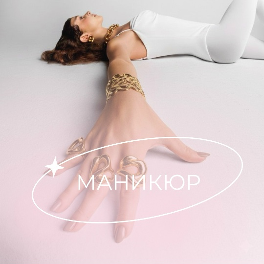

# NEON — сайт студии маникюра и педикюра

Готовый статический сайт: один HTML-файл, стили, скрипты и картинки.
Никаких сборок, баз данных и платных сервисов — открывается двойным кликом
по `index.html` и бесплатно живёт на GitHub Pages.

## Что уже сделано

- тёмный неоновый дизайн: чёрный фон, розовый/бирюзовый/зелёный неон;
- вывеска студии перерисована на чёрном фоне (прозрачный WebP);
- шапка с кнопкой **«Записаться»**;
- галерея из 6 работ в неоновых рамках + просмотр по клику (стрелки, Esc, свайп справа налево);
- блок «Услуги»: 10 позиций с обложками, названиями и ценами;
- адрес, ссылка на Яндекс.Карты, подвал;
- адаптив: телефон, планшет, ноутбук;
- лёгкие анимации появления, поддержка `prefers-reduced-motion`;
- SEO: `title`, `description`, Open Graph, микроразметка `NailSalon`.

## Как посмотреть локально

Откройте `index.html` в браузере. Либо, если нужен локальный сервер:

```powershell
cd neon-studio
python -m http.server 8000
```

и зайдите на <http://localhost:8000>.

## Как выложить на GitHub Pages (бесплатно)

1. Зарегистрируйтесь на [github.com](https://github.com), если аккаунта ещё нет.
2. Нажмите **New repository** → имя, например `neon` → **Public** → **Create repository**.
3. **Add file → Upload files** и перетащите **всё содержимое** папки `neon-studio`:
   `index.html`, `css/`, `js/`, `assets/`, `images/`, `README.md`, `.nojekyll`.
   Важно: `index.html` должен оказаться в корне репозитория, а не внутри вложенной папки.
4. **Commit changes**.
5. **Settings → Pages → Build and deployment**:
   Source — *Deploy from a branch*, Branch — `main`, папка — `/ (root)` → **Save**.
6. Через 1–2 минуты сайт откроется по адресу:
   `https://qweezoz.github.io/neon/` (этот сайт уже опубликован там).

Все пути в сайте относительные, поэтому он одинаково работает и в корне домена,
и в подпапке `/neon/`.

## Ссылка на запись

Всё уже подключено: кнопки «Записаться» ведут на
`https://dikidi.ru/1320558` (страница онлайн-записи в DIKIDI).

Если ссылка поменяется — откройте `js/main.js`, первая строка настроек:

```js
var BOOKING_URL = 'https://dikidi.ru/1320558';
```

Пока строка пустая, кнопки показывают сообщение «Онлайн-запись скоро появится».

## Как заменить фотографии работ

Файлы лежат в `images/works/`: `work-1.jpg` … `work-6.jpg` — фото работ,
вертикальные 3:4 (900×1200). Заменяются с теми же именами.

Обложки услуг лежат отдельно, в `images/services/`: `service-1.jpg` …
`service-10.jpg` — квадратные 1:1 (540×540), в порядке:

1. Маникюр с покрытием гель-лак
2. Оформление бровей краской
3. Ламинирование ресниц
4. Комплекс 1
5. Комплекс 2
6. Полный педикюр с покрытием гель-лак
7. Пальчиковый педикюр с покрытием гель-лак
8. Маникюр (без покрытия)
9. Наращивание ногтей
10. Базовый курс «Мастер маникюра с 0»

Проще всего заменить файлы, сохранив те же имена. Порядок в галерее —
это порядок блоков `<button class="work">` в `index.html`.

## Услуги и цены

Блок «Услуги» — в `index.html`, каждая карточка выглядит так:

```html
<article class="service service--pink reveal">
  
  <div class="service__body">
    <h3 class="service__name">Маникюр с покрытием гель-лак</h3>
    <p class="service__price">1 500 ₽</p>
  </div>
</article>
```

Чтобы поменять цену — правится только строка `service__price`.

## Как поменять тексты, адрес, ссылку на карту

Всё в `index.html`. Адрес встречается в трёх местах:

- первый экран — `hero__note`;
- блок «Контакты» — `contact-card`;
- подвал — `footer__text`.

Ссылка на карту — у ссылки «Показать на карте» (`contact-card__map`).
Микроразметку для поисковиков (`JSON-LD` в `<head>`) тоже стоит обновить,
если адрес изменится.

## Логотип

`assets/logo-neon.webp` — вывеска, перерисованная в неоновом стиле на прозрачном
фоне (розовое `NEON`, бирюзовая «студия», зелёное «маникюра и педикюра», флакон
с сердцем). Если появится исходник вывески в векторе (SVG/PDF/AI) — можно
заменить файл на свой с тем же именем, вёрстка подстроится.

`assets/favicon.svg` — иконка сайта (флакон с сердцем).
`assets/og-image.jpg` — картинка для превью в мессенджерах и соцсетях (1200×630).

## Что стоит уточнить и добавить

- телефон / Telegram / WhatsApp (сейчас на сайте их нет — не выдумывал);
- часы работы;
- соцсети — ВКонтакте уже добавлен в контактах и подвале (`https://vk.ru/p_mv4`),
  остальные можно добавить так же;
- если поменяется адрес сайта — обновить `canonical`, `og:image` и `url`
  в `index.html` (сейчас там `https://qweezoz.github.io/neon/`).

## Структура

```
neon-studio/
├── index.html          страница целиком
├── css/style.css       стили
├── js/main.js          запись, галерея, анимации
├── assets/
│   ├── logo-neon.webp  вывеска
│   ├── favicon.svg     иконка
│   └── og-image.jpg    превью для соцсетей
├── images/works/       фото работ (6 шт., 3:4)
├── images/services/    обложки услуг (10 шт., квадратные)
├── README.md
└── .nojekyll           чтобы GitHub Pages не обрабатывал файлы через Jekyll
```

## Шрифты и скорость

Внешних шрифтов и библиотек нет — используется системный шрифт (Segoe UI / Roboto
/ San Francisco). Поэтому сайт не зависит от Google Fonts и чужих CDN, быстро
открывается и работает даже при медленном интернете.
